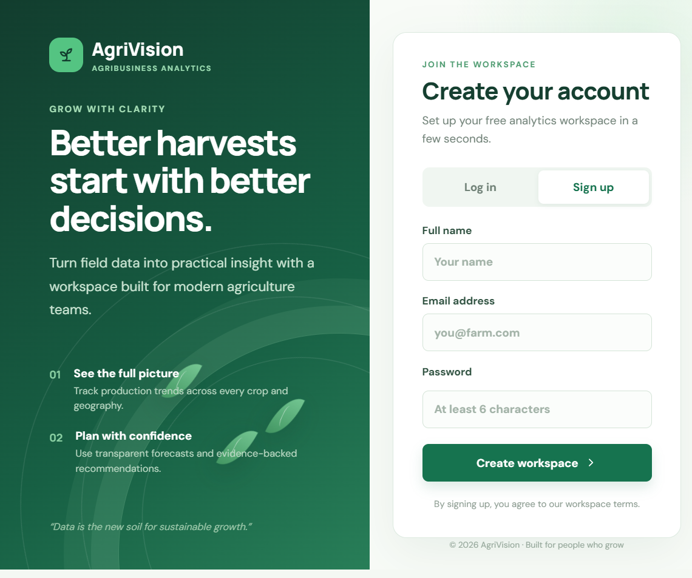
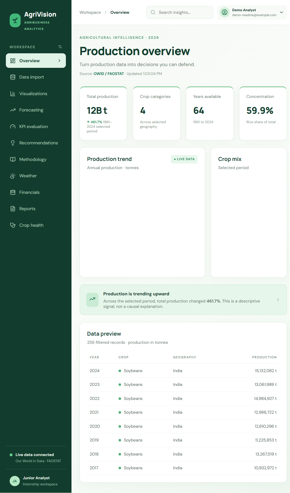
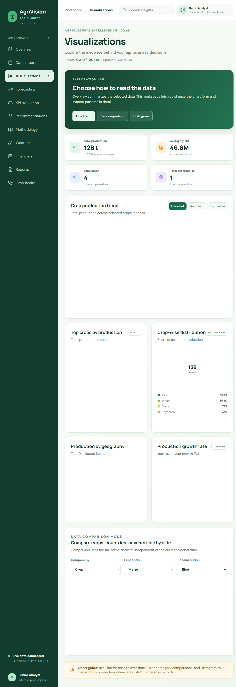

# AgriVision — Smart Agribusiness Analytics Dashboard

AgriVision is an internship portfolio project that converts crop-production data into transparent visualizations, forecasts, KPI evaluations, and evidence-based recommendations. The interface is designed around a clean agribusiness workspace with KPI cards, ranked comparisons, distribution charts, and decision-ready exports.

## Features

- Live default data from Our World in Data Grapher, with FAOSTAT documented as the underlying source.
- Default crop-production charts use the 2000–2026 analysis window; historical values stop at the latest year published by the source, and the Forecasting workspace labels baseline estimates through 2026 separately.
- CSV upload with schema validation and cleaning for missing, duplicate, malformed, and negative-production records.
- Overview and visualization workspaces with trend, bar, histogram, ranked comparison, donut distribution, geography, and growth-rate charts.
- Filters for geography, crop, and year.
- Chronological moving-average forecasting with limitations clearly explained.
- KPI evaluation for production, growth, concentration, yield, revenue, costs, profit, farmer income, water productivity, sustainability, and weather-risk availability.
- Rule-based recommendations linked to the active dataset.
- Methodology and data-source documentation inside the dashboard.
- Weather workspace powered by OpenWeather when `OPENWEATHER_API_KEY` is configured.
- Financial, report export, crop-health upload, and FAOSTAT market-price workspaces.

## Technology

- Frontend: Next.js 16, React, TypeScript, Recharts, Papa Parse, and CSS.
- Backend: FastAPI, Pandas, NumPy, and scikit-learn.
- Current persistence: one cleaned active dataset in backend memory.
- Planned persistence: PostgreSQL.

## Requirements

- Node.js 18 or newer
- npm
- Python 3.10 or newer
- Internet access for the default live OWID data

## Run locally

Install frontend dependencies:

```powershell
cd "D:\Agri Vision"
npm install
```

If dependencies were previously installed with an older Next.js version, restore the lockfile exactly:

```powershell
npm ci
```

Install backend dependencies:

```powershell
cd "D:\Agri Vision\backend"
& "C:\Users\Dushy\AppData\Local\Programs\Python\Python310\python.exe" -m pip install -r requirements.txt
```

Start the backend in the first PowerShell window:

```powershell
cd "D:\Agri Vision\backend"
.\run.ps1
```

Start the frontend in a second PowerShell window:

```powershell
cd "D:\Agri Vision"
npm run dev
```

Open the dashboard at http://localhost:3000.

Open the interactive API documentation at http://127.0.0.1:8000/docs.

The frontend uses `http://127.0.0.1:8000` by default. To use another API URL, copy `.env.example` to `.env.local` and set `NEXT_PUBLIC_API_URL`. If the backend is unavailable, the frontend uses its local CSV validation fallback.

For live weather, set `OPENWEATHER_API_KEY` in `backend/.env`. This file is ignored by Git and loaded automatically by the backend. Keep the key backend-only; do not expose it as a `NEXT_PUBLIC_` variable or commit it to the repository:

```powershell
Set-Content -Path "backend\.env" -Value 'OPENWEATHER_API_KEY=your-openweather-api-key'
```

For crop-health image analysis, set `GROQ_API_KEY` in `backend/.env`. The backend uses `qwen/qwen3.8-27b` by default because it supports image input; override it with `GROQ_VISION_MODEL` if your Groq account uses another available vision model. Crop health provides AI-assisted screening guidance, not a laboratory diagnosis.

The market-price workspace uses the public FAOSTAT producer-price endpoint and may be unavailable when FAOSTAT is rate-limited.

## Screenshots

### Login and workspace entry



### Production dashboard



### Visualization workspace



The screenshots are generated from the local production build using the public OWID/FAOSTAT data source. They are included to make the visual direction and chart layout easy to review without running the app.

## Demo video

The repository currently includes the screenshot walkthrough above but does not commit a recorded video file. To record a current demo locally, run `npm run dev`, open `http://localhost:3000`, and use the browser or operating-system screen recorder while moving through **Overview**, **Visualizations**, **Forecasting**, and **Reports**. This keeps the demo aligned with the current data and avoids committing a stale or oversized recording to the repository.

## Production run

```powershell
cd "D:\Agri Vision"
npm run build
npm start
```

If the browser shows `GET / 404` or `/_next/static/... 404` after a rebuild, stop any older `next start` or `next dev` process and start only one server. Next.js build output is intentionally separated by `next.config.mjs`: production uses `.next`, while development uses `.next-dev`. Starting an old process against a replaced build can make its HTML reference chunks that no longer exist.

## Validation and security

Run the production checks before sharing a build:

```powershell
npm run build
npm audit --omit=dev
```

The current dependency lockfile is audited with zero production vulnerabilities. Do not use `npm audit fix --force` casually in unrelated work because it can introduce a major framework upgrade; review the resulting build whenever dependency remediation is required.

## Backend API

- `GET /health` — service health check.
- `POST /api/data/upload` — clean and activate an uploaded CSV.
- `GET /api/data/summary` — active dataset summary.
- `GET /api/data/trends` — yearly production trends.
- `GET /api/forecast` — chronological forecast and error metrics.
- `GET /api/kpis` — calculated KPI values and availability statuses.
- `GET /api/recommendations` — rule-based recommendations.
- `GET /api/methodology` — active dataset methodology details.

Uploading a new CSV replaces the active in-memory dataset. All subsequent analytics use the cleaned uploaded data.

## CSV format

Required columns:

```text
Year
Production
```

Recognized descriptive columns:

```text
Country or State
Crop
Season
Area
```

Optional columns for extended KPI analysis:

```text
Quantity_Sold
Selling_Price
Revenue
Total_Cost
Farmer_Income
Water_Used
Fertilizer_Used
Pesticide_Used
Carbon_Emissions
Rainfall
Temperature
Drought_Index
Flood_Events
Heatwave_Days
```

Column names are matched flexibly by the backend. Missing optional fields are shown as unavailable; the application does not invent financial, sustainability, or weather values.

## Data cleaning

The upload pipeline:

1. Checks that `Year` and `Production` are present.
2. Converts numeric fields to numeric values.
3. Removes rows with missing required values.
4. Removes negative production and invalid years.
5. Removes duplicate records.
6. Preserves valid optional KPI fields.
7. Reports records before and after cleaning.

## Data source and methodology

The default dashboard loads rice, maize, wheat, and soybean production from the **Our World in Data Grapher**. OWID identifies FAOSTAT as the underlying source. OWID is a third-party presentation/mirror layer, not the official FAO application.

Source documentation: https://ourworldindata.org/agricultural-production

Forecasting uses a transparent five-year moving-average baseline. It is not a causal model and does not account for weather, prices, policy, land-area changes, or unexpected shocks. Production growth and crop concentration are descriptive indicators, not guarantees of future performance.

Profit requires revenue and total cost. Yield requires production and positive cultivated area. Sustainability and weather-risk statuses depend on the corresponding uploaded fields. These metrics are intentionally not estimated when their required inputs are missing.

The in-app Methodology page reports the active source, filter context, row coverage, units, data-quality results, formulas, forecast baseline, and KPI input availability. The quality gate requires `Year` and `Production`, converts numeric values, and excludes incomplete, malformed, negative, and duplicate records. For uploaded CSVs it also reports rows received, rows retained, and each removal category.

The main formulas are:

- Annual trend: sum of production grouped by year.
- Growth: `((latest annual total - first annual total) / first annual total) * 100`.
- Crop concentration: `leading crop production / total production * 100`.
- Yield: `production / positive cultivated area`, when `area` is provided.
- Revenue: `revenue`, or `quantity_sold * selling_price` when both inputs are available.

Forecasts repeat the average production from the latest five available years for the next three years. When enough annual observations exist, the latest historical observations are held out for a chronological baseline check and reported as a percentage error. This is a diagnostic estimate, not a confidence interval or causal forecast.

## Project structure

```text
Agri Vision/
├── app/
│   ├── page.tsx
│   ├── globals.css
│   └── layout.tsx
├── backend/
│   ├── app/
│   │   ├── analytics.py
│   │   └── main.py
│   ├── requirements.txt
│   └── run.ps1
├── .env.example
├── .gitignore
├── next.config.mjs
├── package.json
└── README.md
```

## Security and repository hygiene

- Never commit `.env`, `.env.local`, API keys, passwords, certificates, private keys, or production configuration.
- Do not commit uploaded farmer or operational datasets unless they are sanitized and explicitly intended for publication.
- Keep dependencies installed locally and do not commit `node_modules`, Python virtual environments, caches, or build output.
- Use environment variables for configurable API URLs and future database credentials.

## Current limitations and next steps

- The backend stores one active cleaned dataset in memory and loses it when restarted.
- PostgreSQL persistence and user authentication are not implemented yet.
- Forecasts are baseline estimates and should not be treated as guaranteed outcomes.
- Profitability and sustainability depend on the quality, units, and provenance of uploaded columns.
- Add automated backend tests for cleaning, KPI availability, forecasting, and recommendation rules before deployment.
# Agri-Vision
